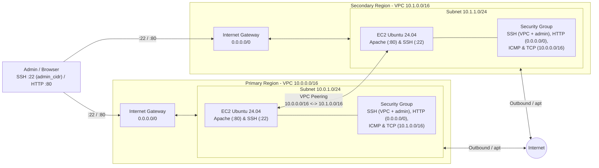
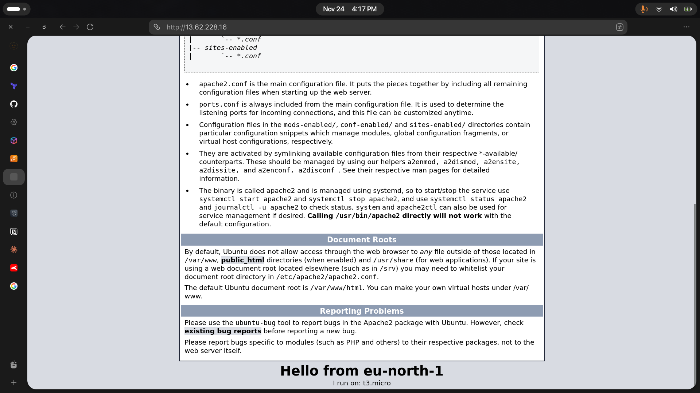
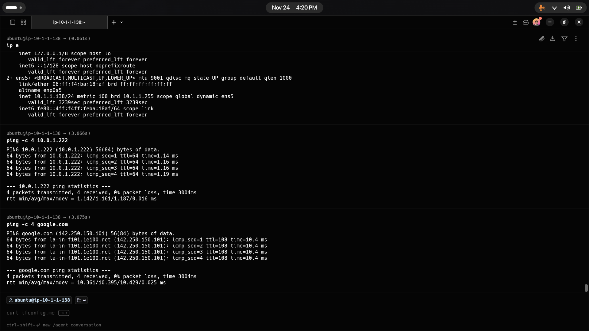

# terraform-aws-vpc-# AWS Multi-Region VPC Peering with Terraform

This project provisions two VPCs in two AWS regions, connects them with a VPC peering connection, and launches an Ubuntu EC2 instance running Apache in each.

## What Was Built

* Two VPCs (`10.0.0.0/16` and `10.1.0.0/16`) across two AWS regions using provider aliases
* Public subnets (`10.0.1.0/24` and `10.1.1.0/24`) with Internet Gateways and default `0.0.0.0/0` routes
* Route table entries pointing each peer CIDR to the VPC peering connection
* Security groups allowing SSH (`22`) from the VPC and an admin IP (`admin_cidr`), HTTP (`80`) from the internet, and ICMP / TCP traffic between the peered VPCs
* EC2 key pairs and Ubuntu 24.04 instances configured via `user_data` to install and run Apache
* Remote Terraform state stored in S3 with encryption and lockfile support

## How It Works

Each region gets its own VPC, subnet, route table, Internet Gateway, security group, key pair, and EC2 instance. A peering connection is created from the primary VPC to the secondary VPC and accepted in the secondary region. Routes in both route tables send traffic for the other VPC's CIDR through the peering connection, while `0.0.0.0/0` routes send outbound and public traffic through each region's Internet Gateway. On boot, `user_data` installs Apache and appends a simple HTML message with the region and instance type.

## Verification

SSH into an instance and test connectivity to the other instance's private IP, the public internet, and the HTTP page:

